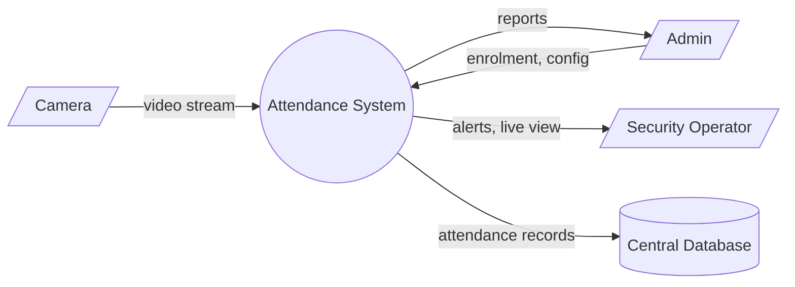
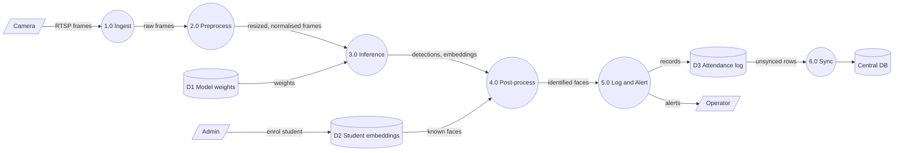

# System Design Specification: Smart Attendance System

**Course:** AI-316, Lab 02

## 1. Overview

An edge-based system that detects and recognises faces from a classroom camera and logs attendance automatically, syncing to a central database when the network allows.

## 1. Requirements for the Smart Attendance System

The idea: a camera at the classroom door recognises students and marks them present automatically.

### Functional requirements

| ID | Requirement | Acceptance criteria |
|----|-------------|---------------------|
| FR-1 | Detect faces in live video | Detection takes under 100 ms per frame |
| FR-2 | Match each face against enrolled students | Match is accepted only at confidence >= 0.85 |
| FR-3 | Log attendance (student ID, timestamp, course) | One entry per student per class session, no duplicates |
| FR-4 | Sync local records to the central database | Sync runs every 5 minutes, retries if the network is down |
| FR-5 | Let an admin enrol, edit or remove students | Changes take effect without restarting the system |

### Non-functional requirements

| ID | Category | Requirement |
|----|----------|-------------|
| NFR-1 | Performance | Process at least 15 FPS on the edge device |
| NFR-2 | Accuracy | Recognition accuracy >= 95%, false accept rate <= 1% |
| NFR-3 | Power | Edge device (Jetson-class) stays under 15 W |
| NFR-4 | Privacy | Face embeddings are stored encrypted, raw frames are never saved |
| NFR-5 | Reliability | 99% uptime during class hours, auto-restart after a crash |

## 2. System Boundary, Actors and I/O

### Actors

| Actor | Role | Interaction |
|-------|------|-------------|
| Security Operator | Watches live feed and alerts | Views dashboard, acknowledges alerts |
| Admin | Manages the system | Enrols people, sets thresholds, exports reports |
| Automated Trigger System | Scheduler or motion sensor | Starts and stops processing for a session |
| Camera (external) | Source of video | Pushes RTSP stream |

### Inputs

| Input | Format | Details |
|-------|--------|---------|
| Video stream | RTSP / H.264 | 1280x720, 25 FPS |
| Sensor parameters | JSON | Motion sensitivity, schedule |
| Enrolment data | JPEG + metadata | 3-5 photos per person |
| Config file | YAML | Thresholds, camera URLs |

### Outputs

| Output | Format | Details |
|--------|--------|---------|
| Bounding boxes | `(x1, y1, x2, y2, conf)` | Per face, per frame |
| Alert notifications | Email / dashboard popup | Unknown person or camera offline |
| Log entries | DB rows + `.log` file | Timestamp, ID, confidence |
| Attendance report | CSV | Per course, per day |

### Operational constraints

| Constraint | Limit |
|------------|-------|
| Memory footprint | Max 2 GB RAM on edge device |
| Bandwidth | Max 4 Mbps per camera stream |
| Latency (frame to log) | Under 500 ms |
| Storage | 32 GB local, logs rotated weekly |
| Connectivity | Must keep working offline and sync later |

## 3. Data-Flow Diagrams

### Level 0 (context)



### Level 1



## 4. Module Architecture

| Module | Responsibility | Input | Output |
|--------|----------------|-------|--------|
| DataIngestion | Pull frames from camera | RTSP URL | BGR frames |
| ImagePreprocessor | Resize, normalise | Raw frame | float32 array |
| ModelInferenceEngine | Run detector | Preprocessed frame | List[Detection] |
| AlertLogger | Log and alert | Identified detections | DB row, notification |

Skeleton code (`src/attendance/interfaces.py`):

```python
"""Interface skeletons for the attendance pipeline (Lab 02, Task 4)."""
from dataclasses import dataclass
from typing import Iterator, List, Optional, Tuple
import numpy as np


@dataclass
class Detection:
    box: Tuple[int, int, int, int]  # x1, y1, x2, y2
    confidence: float
    label: str = "face"
    identity: Optional[str] = None


class DataIngestion:
    """Reads frames from an RTSP stream or video file."""

    def __init__(self, source: str, fps_limit: int = 15) -> None:
        self.source = source
        self.fps_limit = fps_limit

    def connect(self) -> bool:
        """Open the source. Returns True on success."""
        raise NotImplementedError

    def frames(self) -> Iterator[np.ndarray]:
        """Yield BGR frames (H, W, 3) uint8."""
        raise NotImplementedError

    def release(self) -> None:
        raise NotImplementedError


class ImagePreprocessor:
    """Resizes and normalises frames for the model."""

    def __init__(self, size: Tuple[int, int] = (640, 640)) -> None:
        self.size = size

    def process(self, frame: np.ndarray) -> np.ndarray:
        """Return float32 array (H, W, 3) scaled to 0-1."""
        raise NotImplementedError


class ModelInferenceEngine:
    """Loads the detector and runs it on frames."""

    def __init__(self, weights_path: str, conf_threshold: float = 0.5) -> None:
        self.weights_path = weights_path
        self.conf_threshold = conf_threshold

    def load_model(self) -> None:
        raise NotImplementedError

    def predict(self, frame: np.ndarray) -> List[Detection]:
        """Run inference, return detections above the threshold."""
        raise NotImplementedError


class AlertLogger:
    """Writes attendance logs and raises alerts."""

    def __init__(self, db_path: str, log_file: str = "logs/attendance.log") -> None:
        self.db_path = db_path
        self.log_file = log_file

    def log_attendance(self, student_id: str, confidence: float) -> bool:
        """Store a record. Returns False if already logged this session."""
        raise NotImplementedError

    def send_alert(self, message: str, level: str = "WARNING") -> None:
        raise NotImplementedError
```

## 5. Folder Layout

```
docs/  src/attendance/  ARCHITECTURE.md  README.md
```
